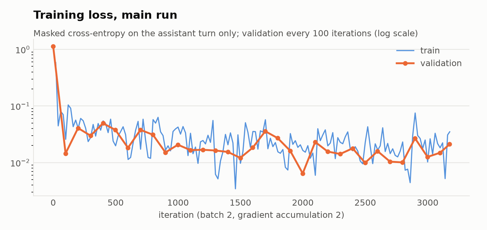
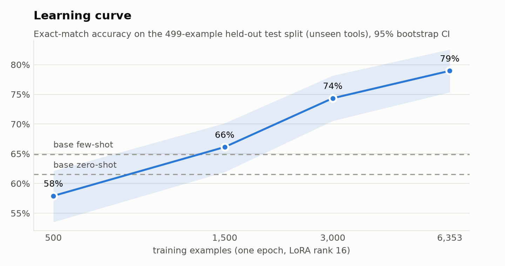
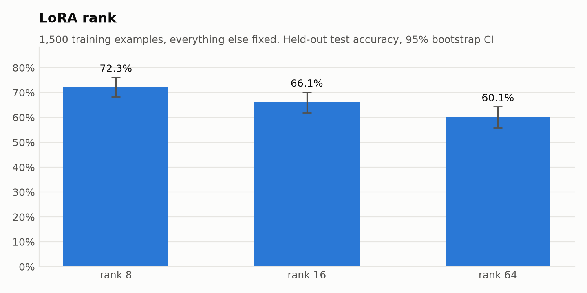
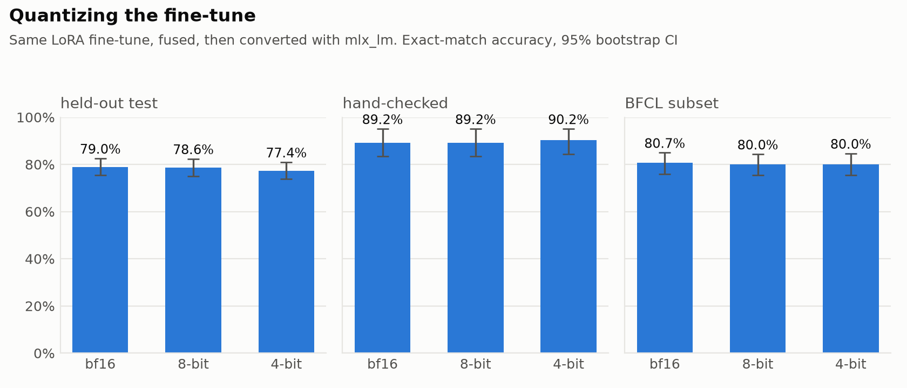
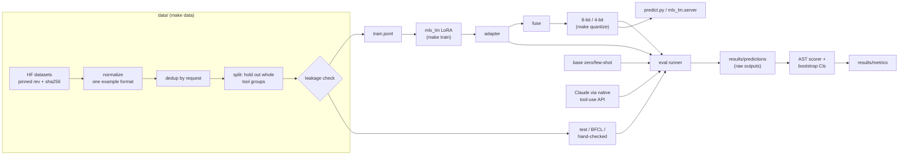

# smolcall

**A 3B model on a laptop that learned when *not* to call a tool.** Small open models can call tools, but they call them for everything: zero-shot, Granite 4.1 3B invokes a tool on 71% of requests that no offered tool can serve. smolcall is a LoRA fine-tune of that model, trained and served entirely on one MacBook with MLX. On tools it never saw in training, the fine-tune cuts false calls to 3% and lifts exact-match accuracy from 61.5% to 79.0%. At 4-bit it runs in 1.1 s and 3.2 GB per call. It does **not** improve on the Berkeley Function-Calling Leaderboard, and this README shows why.

```console
$ python predict.py "Convert 250 US dollars to euros, and also tell me the weather in Lisbon."
[
  {"name": "convert_currency", "arguments": {"amount": 250, "from_currency": "USD", "to_currency": "EUR"}},
  {"name": "get_weather", "arguments": {"city": "Lisbon"}}
]
$ python predict.py "Book me a table for two at 8pm."
[]
```

<sub>Real output of the 4-bit model with [`examples/tools.json`](examples/tools.json) (lightly reformatted). TODO: a terminal GIF of the same.</sub>

## What it does

- **Builds a leakage-checked dataset** from two Apache-2.0 sources:
  - pinned by revision and SHA-256;
  - deduplicated, with whole groups of tools held out so the test set only has unseen tools;
  - plus a 102-example set reviewed by hand.
- **Fine-tunes with `mlx_lm` LoRA** from YAML configs with fixed seeds, logged loss curves, and nested learning-curve subsets.
- **Scores every system with one AST-style scorer:**
  - right function and arguments, with types checked (`"5"` is not `5`) and calls matched in any order;
  - refusals and false calls counted separately;
  - bootstrap confidence intervals on every accuracy.
- **Compares against baselines** under the same prompt and scorer:
  - the base model zero-shot and few-shot;
  - the fine-tune at bf16, 8-bit and 4-bit;
  - a harness for Claude Haiku and Sonnet through the native tool-use API (not run yet, see below).
- **Serves the model** with `predict.py`, an OpenAI-compatible `mlx_lm.server` endpoint, and a published [model card](MODEL_CARD.md).

## Results

Exact-match accuracy with 95% bootstrap intervals. Greedy decoding, one shared prompt, one scorer. Every raw output is in [`results/predictions/`](results/predictions), and `make rescore` recomputes every number below from those outputs, without a GPU or an API key. CI does the same.

<!-- generated by scripts/results_table.py -->
| System | Held-out test (499) | Hand-checked (102) | BFCL subset (300) |
|:--|--:|--:|--:|
| Granite 4.1 3B, zero-shot (bf16) | 61.5% <sub>[57.3%, 65.7%]</sub> | 67.6% <sub>[58.8%, 76.5%]</sub> | **84.7%** <sub>[80.7%, 88.7%]</sub> |
| Granite 4.1 3B, 3-shot (bf16) | 64.9% <sub>[60.7%, 68.9%]</sub> | 73.5% <sub>[65.7%, 82.4%]</sub> | 81.0% <sub>[76.3%, 85.3%]</sub> |
| Granite 4.1 3B, zero-shot (4-bit) | 56.7% <sub>[52.3%, 60.9%]</sub> | 59.8% <sub>[50.0%, 69.6%]</sub> | 76.3% <sub>[71.3%, 81.0%]</sub> |
| **smolcall** LoRA fine-tune (bf16) | **79.0%** <sub>[75.4%, 82.6%]</sub> | 89.2% <sub>[83.3%, 95.1%]</sub> | 80.7% <sub>[76.0%, 85.0%]</sub> |
| **smolcall** fine-tune (8-bit) | 78.6% <sub>[74.9%, 82.4%]</sub> | 89.2% <sub>[83.3%, 95.1%]</sub> | 80.0% <sub>[75.3%, 84.3%]</sub> |
| **smolcall** fine-tune (4-bit) | 77.4% <sub>[73.7%, 81.0%]</sub> | **90.2%** <sub>[84.3%, 95.1%]</sub> | 80.0% <sub>[75.3%, 84.7%]</sub> |
| claude-haiku-5-5 (native tool use) | _pending_ | _pending_ | _pending_ |
| claude-sonnet-5-5 (native tool use) | _pending_ | _pending_ | _pending_ |

> **TODO: frontier rows.** The Claude baselines are implemented ([`src/smolcall/eval/frontier.py`](src/smolcall/eval/frontier.py), tested against a stubbed client) but have not been run: the machine these results come from has no API key. Run `make eval-frontier` with `ANTHROPIC_API_KEY` set, then `uv run python scripts/results_table.py`. These rows are filled in only from real runs, never estimated. Until then, nothing here claims the fine-tune is "almost as good as a frontier model".

**Speed and cost on the laptop.** Apple M6 with 32 GB unified memory. One request at a time on the same 40 test requests, after 3 warmup requests:

| System | p50 latency | p95 latency | gen tok/s | peak memory | size on disk | cost / 1k calls |
|:--|--:|--:|--:|--:|--:|--:|
| Granite 4.1 3B, zero-shot (bf16) | 2.64 s | 18.25 s | 22 | 7.5 GB | 6.8 GB | ~$0.010 (electricity, est.) |
| Granite 4.1 3B, zero-shot (4-bit) | 0.96 s | 5.14 s | 56 | 3.2 GB | 2.5 GB | ~$0.004 (electricity, est.) |
| **smolcall** LoRA fine-tune (bf16) | 2.13 s | 19.17 s | 25 | 7.5 GB | 6.8 GB | ~$0.010 (electricity, est.) |
| **smolcall** fine-tune (8-bit) | 1.33 s | 10.74 s | 46 | 4.2 GB | 3.6 GB | ~$0.006 (electricity, est.) |
| **smolcall** fine-tune (4-bit) | 1.09 s | 7.60 s | 66 | 3.2 GB | 2.5 GB | ~$0.004 (electricity, est.) |
| claude-haiku-5-5 | _pending_ | _pending_ | - | - | - | _pending_ |
| claude-sonnet-5-5 | _pending_ | _pending_ | - | - | - | _pending_ |

Local cost is electricity only. It is an estimate: an assumed 30 W whole-machine draw at $0.30/kWh, since power can't be read without root. API cost will be measured from the token counts the API returns, priced at the current list price (Haiku 5.5 $0.10 / $0.50 and Sonnet 5.5 $2 / $10 per million input / output tokens). The p95 latencies are long multi-call answers to long hermes requests.

**Where the accuracy comes from.** Breakdown on the held-out test split:

| System | JSON valid | right tool names | multi-call | no-tool correct | false-call rate |
|:--|--:|--:|--:|--:|--:|
| Granite 4.1 3B, zero-shot (bf16) | 97.2% | 79.0% | 64.0% | 29.2% | 70.8% |
| Granite 4.1 3B, 3-shot (bf16) | 97.8% | 80.6% | 62.8% | 46.2% | 53.8% |
| Granite 4.1 3B, zero-shot (4-bit) | 96.8% | 74.2% | 37.2% | 15.4% | 83.1% |
| **smolcall** LoRA fine-tune (bf16) | 98.2% | 87.6% | 69.2% | 96.9% | 3.1% |
| **smolcall** fine-tune (8-bit) | 97.8% | 87.1% | 68.0% | 96.9% | 3.1% |
| **smolcall** fine-tune (4-bit) | 97.8% | 86.4% | 64.5% | 96.9% | 3.1% |

Three things stand out:
- **Most of the gain is refusal.** The base model already writes valid JSON and mostly picks the right tool. What it can't do is decline: it calls a tool on 71% of requests that no tool fits, and three examples in the prompt only bring that down to 54%. Fine-tuning brings it to 3%.
- **BFCL goes the other way.** On BFCL, the base model at 84.7% is better than the fine-tune at 80.7%; the intervals overlap. On BFCL's "irrelevance" questions the fine-tune calls a tool 53% of the time, against 33% for the base. It learned glaive's idea of "no tool fits", which is mostly "the user asked for something the tool plainly doesn't do". It didn't learn BFCL's near-miss version: a physics question with a BMI tool, or "integrate x³" with a `str_to_int` tool. See [error analysis](#error-analysis).
- **Fine-tuning made the model robust to quantization; the base isn't.** The fine-tune loses 1.6 points from bf16 to 4-bit on the test split. The base loses 4.8 points on test and 8.4 on BFCL, and its multi-call accuracy halves (64% → 37%) because it starts writing `[call], [call]` and stopping early. At the size people actually run on a laptop (4-bit), the fine-tune beats the base on all three splits: +20.7, +30.4 and +3.7 points.

### Training and ablations



Almost all of the loss drop happens in the first 100 steps, while the model learns the output format and when to answer `[]`. The validation set is only 50 examples per check, so its curve is noisy.



| Run | Train examples | LoRA rank | Held-out test | Hand-checked | test multi-call | test JSON valid | train time | peak memory |
|:--|--:|--:|--:|--:|--:|--:|--:|--:|
| `n500` | 500 | 16 | 57.9% <sub>[53.5%, 62.1%]</sub> | 77.5% <sub>[68.6%, 85.3%]</sub> | 50.0% | 92.4% | 8 min | 10.8 GB |
| `n1500` | 1,500 | 16 | 66.1% <sub>[61.9%, 70.1%]</sub> | 84.3% <sub>[76.5%, 91.2%]</sub> | 46.5% | 94.4% | 23 min | 10.7 GB |
| `n3000` | 3,000 | 16 | 74.3% <sub>[70.5%, 78.2%]</sub> | 87.3% <sub>[80.4%, 93.1%]</sub> | 59.9% | 98.8% | 45 min | 10.9 GB |
| `main` | 6,353 | 16 | **79.0%** <sub>[75.4%, 82.6%]</sub> | **89.2%** <sub>[83.3%, 95.1%]</sub> | 68.6% | 97.8% | 106 min | 11.0 GB |
| `n1500-r8` | 1,500 | 8 | 72.3% <sub>[68.3%, 76.2%]</sub> | **89.2%** <sub>[83.3%, 95.1%]</sub> | 59.3% | 96.0% | 22 min | 10.5 GB |
| `n1500-r64` | 1,500 | 64 | 60.1% <sub>[55.9%, 64.3%]</sub> | 78.4% <sub>[70.6%, 86.3%]</sub> | 48.8% | 91.4% | 23 min | 12.2 GB |

All runs evaluate the unfused adapter on the bf16 base. One epoch each, seed 0, every other setting as in [`configs/main.yaml`](configs/main.yaml).

- **More data keeps helping, and hasn't flattened by 6.4k examples.**
  - The refusal behaviour is learned almost immediately: 500 examples already cut the false-call rate to 3%.
  - Multi-call takes the longest: 50% at 500 examples, 69% at 6.4k.
  - With 500 examples the test score (57.9%) is *below* the untuned base (61.5%), because multi-call output gets worse before it gets better. The hand-checked score is already +10 points at that size.
- **Lower rank was better at 1,500 examples**, monotonically on both splits:
  - rank 8 is 72.3%, rank 16 is 66.1%, rank 64 is 60.1%;
  - rank 8 with 1.5k examples matches the full rank-16 run on the hand-checked set.

  A likely reason: `mlx_lm` multiplies the LoRA output by a fixed `scale` (2.0 here), with no `alpha / r`. At a fixed learning rate, a higher rank therefore makes a larger effective update, which overfits a small dataset. This is one seed per configuration, so read the shape rather than the exact gaps. Whether rank 8 on the full data beats `main` is on the roadmap.





**Quantization.** bf16, 8-bit and 4-bit versions of the same fine-tune are within each other's intervals on every split. 4-bit costs 1.6 points on test and nothing measurable elsewhere, for 2.3× less peak memory (7.5 → 3.2 GB) and 2.6× more tokens/s.

## How it works



- **One prompt for every local system** ([`prompt.py`](src/smolcall/prompt.py)). Tools go in the system message as JSON Schema, and the answer is a bare JSON array of calls, `[]` to call nothing. Training uses exactly this text. Claude gets the same instruction text with the tools passed as native API tools.
- **One scorer for every system** ([`scorer.py`](src/smolcall/eval/scorer.py)):
  - parses output leniently, accepting code fences, one object per line, or one array per call, but never guesses at malformed JSON;
  - matches calls with a bipartite matching, compares values by type and value, and allows extra arguments only when they equal the schema default;
  - gives every failure one label: wrong tool, hallucinated argument, missed multi-call, false call, and so on.
- **Leakage-safe splits** ([`split.py`](src/smolcall/data/split.py)). Tools offered together are linked into groups. Each group goes wholly to test or wholly to train, so no test tool is ever seen in training, and the build fails on any shared id, request or held-out tool.

## Quickstart

Requires Apple Silicon (MLX), Python 3.12 and [uv](https://docs.astral.sh/uv/).

```bash
git clone https://github.com/nikolasss4/smolcall && cd smolcall
make install                # uv sync --all-extras
make data                   # download pinned sources (~290 MB), verify hashes, build splits
make train                  # ~105 min on an M6 / 32 GB
make quantize               # fuse + 8-bit + 4-bit (writes models/)
python predict.py "What's the weather in Oslo, in fahrenheit?"
```

**OpenAI-compatible endpoint.** `mlx_lm.server` speaks chat completions. Send smolcall's system prompt and parse the JSON array that comes back:

```bash
uv run mlx_lm.server --model models/smolcall-4bit --port 8080
SYS=$(uv run smolcall prompt --tools examples/tools.json | python3 -c 'import json,sys; print(json.dumps(sys.stdin.read()))')
curl -s localhost:8080/v1/chat/completions -H 'Content-Type: application/json' -d "{
  \"messages\": [{\"role\": \"system\", \"content\": $SYS},
                 {\"role\": \"user\", \"content\": \"Is it raining in Tokyo?\"}],
  \"temperature\": 0, \"max_tokens\": 200}"
# ... "content": "[{\"name\": \"get_weather\", \"arguments\": {\"city\": \"Tokyo\"}}]"
```

[`examples/server_client.py`](examples/server_client.py) does the same in Python with the standard library.

## Reproduce this

Every number above came from these commands, on an Apple M6 with 32 GB unified memory, macOS 27.0.1, `mlx` 0.32.4 and `mlx-lm` 0.32.2:

```bash
make data            # splits must match the sha256s in data/stats.json
make train           # runs/main: 3,177 steps, 106 min, 11.0 GB peak
make quantize
make eval-local      # all local systems on test, hand-checked and BFCL (~1.5 h)
make bench           # latency / memory table
make ablations       # 5 more LoRA runs + their evals (~2.5 h)
make eval-frontier   # needs ANTHROPIC_API_KEY
make charts && uv run python scripts/results_table.py
```

Re-scoring needs neither MLX nor a key: `make rescore` replays the committed raw outputs through the current scorer and fails if any committed metric changes. CI runs it on Linux on every push.

Two practical notes from running this:
- **Run training and evaluation one at a time on a 32 GB machine.** Running both at once pushed the machine into swap and both stalled.
- **Batch size 4 runs out of GPU memory on 32 GB.** Use batch 2 with gradient accumulation 2, which is what the configs do.

## Should you fine-tune?

**Yes, if:**
- your failure is behavioural: calling tools when it shouldn't, wrong format, the wrong one of two similar tools;
- you can describe the right behaviour with a few thousand examples;
- the request distribution is close to your training data.

Here that bought +17.5 points on unseen tools for about two hours of laptop time. It also gave a 4-bit model that is 20 points better than the 4-bit base and runs in about a second, with no API bill and no data leaving the machine.

**No, or not yet, if:**
- **Requests in production won't look like your training data.** The BFCL result is the warning: the same fine-tune is no better than the base on a benchmark written differently, and refuses worse on its trickier irrelevance cases.
- **You haven't tried a few-shot prompt yet.** It costs nothing. Here it was worth +3.4 points on test and +5.9 on the hand-checked set, and it hurt on BFCL.
- **You need the best accuracy available.** That's what the frontier rows are for. Until they're filled in, this repo makes no claim either way.
- **You can't build an eval you trust first.** A third of the automatic labels I reviewed were unusable (see below). Without the hand-checked set it would be hard to tell real gains from fitting the dataset's quirks.

## Error analysis

Failures by kind, over all 901 evaluated examples. Produced by `uv run python scripts/error_analysis.py ft ft-4bit base base-fewshot`:

| error | ft | ft-4bit | base | base-fewshot |
|:--|--:|--:|--:|--:|
| invalid_json | 11 | 13 | 24 | 21 |
| over_call | 34 | 34 | 85 | 76 |
| missed_call | 6 | 7 | 0 | 0 |
| wrong_tool | 3 | 2 | 4 | 1 |
| missed_multi_call | 15 | 23 | 18 | 19 |
| extra_call | 34 | 28 | 72 | 72 |
| hallucinated_arg | 1 | 3 | 2 | 2 |
| missing_arg | 5 | 8 | 3 | 4 |
| wrong_type | 7 | 6 | 8 | 6 |
| wrong_value | 58 | 59 | 55 | 58 |
| **failures / examples** | 174 / 901 | 183 / 901 | 271 / 901 | 259 / 901 |

Fine-tuning removes most false calls (85 → 34) and extra calls (72 → 34). It does nothing for wrong argument values (55 → 58), which are now the largest group. Its only new failure mode is `missed_call`, refusing when it should call.

What the categories look like in practice. These are real outputs of the bf16 or 4-bit fine-tune:

- **False calls on near-miss tools** (`over_call`, almost all on BFCL):
  - "Find the integral of x^3 from 1 to 5", offered only `str_to_int` → `str_to_int(value="x^3")`;
  - "What is the assist average of LeBron James?", offered `player_stats.average_scoring` → calls it.

  The training data's refusals are for requests that obviously don't match the tool, so the model learned "same topic → call".
- **Refusing tools with no arguments** (`missed_call`). It answers `[]` to "I need a new invoice number" when `generate_invoice_number()` takes no arguments, and the same for `generate_random_song` and `generate_phone_number`. glaive's labels do this too: 5 of the 40 "no call" labels I reviewed were exactly this mistake. The model learned the label noise.
- **Running ahead in dependent chains** (`extra_call`). Asked to move a warehouse robot, pick up a package and deliver it, it emits all three calls at once. The gold answer stops after `navigate_robot`, because later steps depend on its result. Sometimes this is arguably right: hermes gold labels leave out calls whose arguments the user did give. That is why the hand-checked set drops ambiguous cases.
- **Stopping early on multi-call** (`missed_multi_call`): "calculate the optimal route and estimate the travel time" → only the route call.
- **Paraphrased values** (`wrong_value`, the largest group on the automatic test split):
  - `household_size` for "household size";
  - `"Bengal Tiger"` for "Bengal Tigers".

  Many of these are gold-label choices rather than model errors, which is why the hand-checked set (where such items were dropped) is 10 points higher than the automatic split.
- **Invented namespaces** (`wrong_tool`): calling `functions.extract_legal_clauses` because the request text mentioned `functions.extract_legal_clauses`.

**Where frontier models are expected to win** is on exactly these: near-miss irrelevance, chains with dependencies, and value normalization. That's an expectation from the error profile, not a measurement. The frontier rows above will show whether it holds.

### How clean is the test data?

I reviewed 150 automatically labelled test examples one by one. The full log is in [`data/handchecked_review.json`](data/handchecked_review.json):

| | count |
|:--|--:|
| kept as is | 97 |
| relabelled: gold said "call nothing", but every argument was given or the tool takes none | 5 |
| dropped: gold invents a value the user never gave | 14 |
| dropped: several answers are reasonable, gold picks one ("AAPL" vs "Apple", "7:00 AM" vs "07:00") | 16 |
| dropped: gold invents nested structure the schema doesn't define | 10 |
| dropped: gold leaves out a call the user asked for with every argument given | 4 |
| dropped: gold is re-serialized JSON no model could reproduce byte-for-byte | 4 |

So treat the held-out test split as "agreement with the dataset's labelling style", and the hand-checked set as the cleaner but smaller signal. Both are reported everywhere.

## Design decisions

- [ADR 0001](docs/adr/0001-base-model.md): **Granite 4.1 3B.** Apache-2.0, recent (April 2026), plain dense architecture, the best-trodden path through MLX LoRA, fuse and convert.
- [ADR 0002](docs/adr/0002-datasets.md): **glaive v2 + hermes for training, BFCL for evaluation only.**
  - All Apache-2.0.
  - xLAM was skipped because it is gated.
  - ToolACE was skipped because it was generated with GPT models.
  - **No training data was generated with Claude or any frontier model**, which Anthropic's terms restrict and which would make the comparison circular.
- [ADR 0003](docs/adr/0003-lora.md): **LoRA on bf16, then quantize.**
  - A full fine-tune doesn't fit in 32 GB.
  - QLoRA would bake quantization in before training, so its cost could no longer be measured on its own.

## Limitations

- **The frontier comparison is missing** until someone runs it with a key. The headline is fine-tune vs base, not fine-tune vs Claude.
- **No gain on BFCL, and worse irrelevance detection there.** The fine-tune does not generalize past its training distribution's notion of "irrelevant".
- **Single turn only.** No multi-turn conversations, no reading tool results, no follow-up calls.
- **Synthetic training data**, written by other models for the glaive and hermes datasets. It inherits their quirks: refusing argument-less tools, and hermes's habit of stopping dependent chains at step one.
- **One seed per configuration.** Differences of 1-2 points between runs (bf16 vs 8-bit, or neighbouring ablation points) are within noise. The bootstrap intervals cover sampling noise in the test sets, not training variance.
- **Power is estimated, not measured.**
- **English only.**

## Roadmap

- [ ] Run the Claude baselines and fill in the frontier rows and the API cost column.
- [ ] Add near-miss irrelevance examples to training (generated from the tool schemas by rules, not by a frontier model) and re-measure BFCL irrelevance.
- [ ] Fix the label noise in training: relabel argument-less tools.
- [ ] 3 seeds per configuration for the ablations, and rank 8 on the full training set.
- [ ] Multi-turn: train and evaluate on follow-up turns with tool results.
- [ ] Publish the adapter and the 4-bit model to Hugging Face (needs the owner's account and OK). The model card is ready.
- [ ] Use smolcall as a local provider in [tracejudge](https://github.com/nikolasss4/tracejudge) and as the tool-caller in [glassbox](https://github.com/nikolasss4/glassbox).

## License

MIT for the code. The model weights inherit Apache-2.0 from Granite 4.1, and the data is Apache-2.0 from glaive, hermes and BFCL. See [MODEL_CARD.md](MODEL_CARD.md) for attribution.
